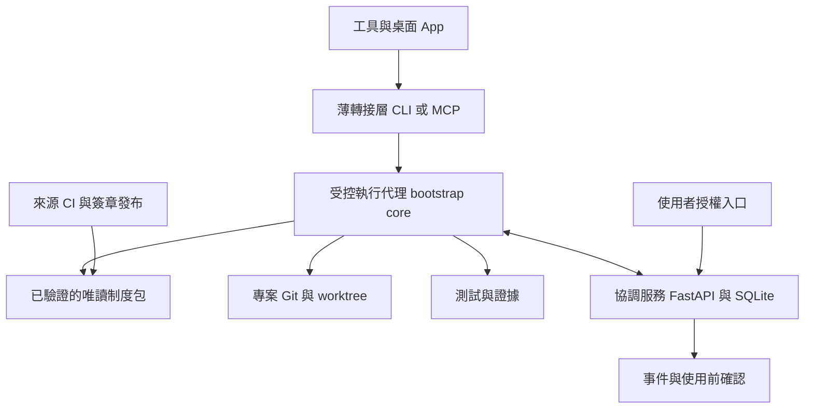

# project-bootstrap 需求實現與技術棧規劃

> 最後更新：2026-11-06
> 狀態：**2026-11-06 使用者已授權在 `codex/project-bootstrap_v2` 按本方向實作；尚未部署、未取代現行程序**。依據 [需求決策書](project-bootstrap-requirements-decision.md) 決策版本 2；涵蓋全部 51 個需求 ID（含 v2 啟動補登的 F50）。
> 本機查核基準：`01d60c6`（需求整理完成），骨架 `VERSION=2026-11-03`。本輪只修復誤觸的決策書檔名、研究與撰寫文件，沒有安裝候選工具或呼叫額外模型。
> 外部資料：2026-11-06 讀取官方文件、官方 repo 與 LICENSE；屬文件查證，**不是整合實測**。選型理由是本規劃的判斷；不把供應者功能描述當成需求驗收。

## 1. 結論：保留制度領域核心，替換通用基礎能力

推薦 **Python 共用核心＋Git／結構化檔案＋成熟檢查元件＋受控執行代理＋小型協調服務**。project-bootstrap 縮成負責本制度特有語意的整合層，不再手寫套件安裝、Markdown parser、通用祕密規則或整套測試框架。

不是整套保留現有實作，也不是裝一個 AI 工作流框架就結束：

- **保留並改造**：Git／writer 判讀、專案自訂設定保全、部署與同步反例、驗證結果分類、帶理由的交接制度。
- **交給開源元件**：uv 管執行環境；JSON Schema 管結構；markdown-it-py 解析 Markdown；pytest／Hypothesis 執行反例；Gitleaks 掃描已知祕密模式；pre-commit 提供本機快速回饋；MADR 提供決策記錄格式；Cosign 驗證發布物身分與完整性。
- **必須補的領域能力**：證據依賴與失效、授權範圍、受控寫入與提交、共用前提變更通知及使用前確認、完整事件歸因。候選工具沒有直接交付這整組契約。
- **不強制導入**：OpenSpec／Spec Kit／Beads 可提供規格或任務工作流，但不作安全核心；本規劃選小型 Git 原生任務資料為預設，理由與替換條件見第 3 節。

**先做最難保障的可行性實驗，再大搬家。** F11(b)、F28、F42／F43(a)／F48 是架構門檻。若工具不能被限制到受控入口，就如實標未達成；不能換成「提醒 AI 記得做」而宣稱符合必要強度。

## 2. 現有能力盤點：哪些可用、哪些不能推論

這是本次基準的選型依據，不是持續更新的達成表。逐 ID／子項實作進度已移交 [v2 現況索引](experiments/v2/status.json)；[HANDOFF](HANDOFF.md) 保留行動與停點。下面的「有」指程式／程序存在，不代表完整需求通過。

| 基準下的能力與證據 | 可保留的價值 | 尚不能提供的保障／建議處置 |
|---|---|---|
| [部署包](PROJECT-BOOTSTRAP.md) 內嵌 22 檔；[驗證器](tools/verify_bootstrap.py) `extract()`／`build_zip()` | 可重建、已有生命週期反例 | 權威程式拆成正常來源檔，部署說明改為生成文件；切換前仍遵守現行部署包權威 |
| `verify_bootstrap.py` 本輪 Mac 實跑 exit 0、51 項、無 skip | CLI、local bare Git、同步、負向變異等既有測試資產 | 51 項不是現行 51 個需求的逐項驗收（數字相同不代表對應）；未實測 Windows、Linux 或模型遵循。移入 pytest 後保留一鍵入口 |
| [同步器](tools/sync_project.py) `Plan`、`preflight()`、`sync_owner_check()` | 先預演、檢查 upstream／遠端 owner、已知內容漂移與自訂 handler 保全 | 不 commit；逐檔 replace 不是整批交易。保留作舊專案遷移器，停止以它常態散發制度副本 |
| `known_hook_commands()`／`merge_group()`、`apply_plan()` | R01／R02 命令所有權與 matcher 防護、mode 保留已在程式與回歸案例內 | 不把 2026-11-03 舊反例照抄成仍未修；其他輸入邊界仍需驗 |
| 生成 `check_docs.py`：連結、快照、staged 集合；生成 `verify_state.py`：PASS／FAIL／ERROR／SKIP | 沿用專案設定與狀態分類；R04 已先 mask 再截斷，R07–R09 有回歸項 | parser 換通用元件；檢查設定變資料；遮罩僅涵蓋已知值，不能等同 F43 全面提交阻擋 |
| A／B／C 與 `HANDOFF.md` 工作中標記 | 有可追溯的人機接力程序 | 是協調訊號，不是身分證明、互斥鎖或 F11(b) 覆寫事件記錄 |
| `git-freshness.sh` 版本快取 720 分鐘；`VERSION` 只追 skill | 已有版本方向判讀與跨工具接線 | 不符合逐次確認最新的 D5／F33；hook 單獨更新也不一定觸發落後提示。換整包 manifest 與線上版本確認 |
| 3.11 `pre-push-handoff.sh` 是 AI 命令文字提醒 | 可提示常見誤推 | 不是 Git 原生 hook；選項、GUI、間接命令可漏過。不能當 F35 發布安全邊界 |
| `--zip` 拒絕 FAIL，SKIP 調試產物附 UNVERIFIED 且非零退出 | 保留發布前查核和負向案例 | 必須再保護正式發布權限，拒絕調試包進正式 channel；不是任意 Git push 都已被阻擋 |
| [來源例外](ARCHITECT.md) 刻意少三項防護 | 已有明確決策，保留例外 | 做 F46 情境對照並列缺項；本計畫不撤銷例外、不偷偷補裝 |

已讀 [第二輪複審](project-bootstrap-reaudit-2026-11-03.md)，但本輪不是 R01–R09 的全面獨立複審。舊反例與新需求缺口分開處理。

**可量測的成本反例**：本輪工作中版本 `4eac5c6`，以 `len(Path(...).read_text())` 計 Unicode 字元，AGENTS 10,621、全域 handoff skill 22,040、指定複審 8,698、HANDOFF 3,018，合計 **44,377**。這個常態入口已超 F22 的 12,000 上限；不是 token 數，也不是完整開場耗時。不能因驗證全過就說 F22 達成。

## 3. 開源候選比較與取捨

判準依序為：能否提供所需強度與失敗行為、跨工具／平台可驗收性、單一權威、維運與遷移成本、撤換容易度。以下為定性選型，沒有虛構效能分數或基準測試。MIT 等授權標示是本次上游資料摘要；實際交付須在鎖定版本時保存 LICENSE 與相依清單。

### 3.1 規格、記憶與模板

| 候選／官方來源 | 能提供什麼 | 不能代替什麼 | 建議 |
|---|---|---|---|
| [OpenSpec](https://github.com/Fission-AI/OpenSpec)（MIT） | 變更提案、規格、設計、任務與封存；有多工具入口 | 檔案權限、證據真值、寫入授權與即時使用前通知 | **選用的規格工作台**。大型行為變更可用；不要求每個小改都建立完整套件。npm 路線需 Node 22.12+，另有安裝器；不為核心強加此依賴 |
| [Spec Kit](https://github.com/github/spec-kit)（MIT） | constitution、規格到計畫／任務；現版亦有 bug、assessment、可替換工作流／擴充 | 產出的分析／驗證報告不等於不可繞過的執行閘門 | **替代 OpenSpec 的選項，不同時導入**。需要統一開發工作流時再採用；Python 3.11+／uv 路線與核心相容，但本案已有需求，不值得僅為重寫文件全面遷移 |
| [Beads](https://github.com/gastownhall/beads)（MIT） | 依賴任務圖、JSON 輸出、ready 任務與持久記憶 | issue 的 claim 不是本 repo writer 資格；任務完成不證明測試通過 | **暫不作預設**。現版使用 Dolt；內嵌模式 single writer，server 模式及跨機同步有另一套生命週期。若 20 專案試驗證明 Git 任務資料難用，優先試它，避免重造完整任務管理器 |
| [MADR](https://github.com/adr/madr)（MIT 或 CC0） | 小型 Markdown 決策記錄，保留選項、理由與後果 | 不判斷決策正確，也不自動合流 | **採用最小模板**；只記重要決策，不另做任務進度副本 |
| [Copier](https://github.com/copier-org/copier)（MIT） | 模板生成、答案與更新流程 | 模板副本更新不能滿足 D3 的共用制度指標；更新也不自動遵守本 repo owner 條件 | **暫不作核心**。初期復用現有 extract；若專案自有模板組合增多，再用 Copier 管 INSTANCE，不把共用 policy 複製回每個 repo |

預設的任務／需求登記採 Git 內小型 JSON 記錄＋Markdown 視圖，**不是自建 Beads**：只做 ID、狀態、理由連結、證據指標、相依與待決，不做排程器、聊天記憶、語意壓縮、看板產品。若超出這個界線，就改採 Beads，並一次移交狀態權威；不能兩邊同時更新。

### 3.2 檢查、發布與安全

| 候選／官方來源 | 評估與選擇 |
|---|---|
| [uv](https://docs.astral.sh/uv/guides/tools/)（MIT／Apache-2.0） | **採用**：隔離安裝核心 CLI、鎖定開發相依。`uv tool upgrade` 遵守版本限制，不代表每次執行自動取得最新；D5 由核心另外確認 |
| [JSON Schema／jsonschema](https://python-jsonschema.readthedocs.io/en/stable/)（MIT） | **採用**：驗 manifest、證據與專案設定；schema 合格不等於事實正確。format 驗證須明確啟用 |
| [markdown-it-py](https://github.com/executablebooks/markdown-it-py)（MIT） | **採用**：取代有限 regex 的 Markdown 連結解析；繼續保留本案本機路徑與 staged 集合規則 |
| [pytest](https://github.com/pytest-dev/pytest)＋[Hypothesis](https://hypothesis.readthedocs.io/en/latest/stateful.html) | **採用**：案例分類、fixture、狀態序列與輸入組合測試。Hypothesis 不取代已知事故回歸，新增檢查仍需可失敗反例 |
| [pre-commit](https://pre-commit.com/)（MIT）／[Lefthook](https://github.com/evilmartians/lefthook)（MIT） | **選 pre-commit**：與 Python 工具鏈一致、便於整合現有檢查。Lefthook 單一 Go 執行檔及平行工作適合較多異質工具時再評估；沒有量測證明本案需要換它。兩者都是可繞過的本機回饋層 |
| [Gitleaks](https://github.com/gitleaks/gitleaks)（MIT）／[Betterleaks](https://github.com/betterleaks/betterleaks)（MIT） | **選 Gitleaks CLI 的離線掃描**＋專案私有已知值／禁入類型檢查。Gitleaks 上游已宣告功能完成、後續安全修補，開發重心移往 Betterleaks；這是升級風險而非立刻不能用。Betterleaks 留作替換候選，其驗證／撤銷功能可能對外連線或改外部狀態，不能預設啟用 |
| [Cosign](https://github.com/sigstore/cosign)（Apache-2.0） | **採用於正式發布**：驗證包與 manifest 簽章、指定信任身分／金鑰。簽章證明來源與完整性，不證明測試真的正確；要綁定 CI 結果與內容 digest |
| [OPA](https://www.openpolicyagent.org/docs/management-bundles)（Apache-2.0） | **暫緩**：策略 bundle、Rego 決策適合多個獨立系統共用規則；本案先以小型 Python 狀態機＋受限 schema 表達。OPA 仍需 enforcement point，裝它不會自行阻止 shell；避免早期再維護一種規則語言 |
| [sandbox-runtime](https://github.com/anthropics/sandbox-runtime)（Apache-2.0） | **強保障原型候選**：OS 檔案與網路限制；官方列 macOS／Linux，Windows 是 alpha。必須逐平台驗證逃逸與繞過路徑。不能因 CLI 可包就宣稱桌面 App、MCP 服務與原生寫檔都被包住 |

Gitleaks 採 CLI，不預設使用另一套授權條件的代管 Action。各元件都需固定發布版本與 digest，不在生產入口執行遠端 `curl | sh` 或未鎖定的 `latest`。本輪只評估，沒有安裝或掃描私人憑證。

### 3.3 通知與協調

| 候選／官方來源 | 評估與選擇 |
|---|---|
| [MCP Agent Mail](https://github.com/Dicklesworthstone/mcp_agent_mail) | 有 inbox／thread 與 advisory reservation；不足以單獨證明 F28 的使用前確認。其[現行 LICENSE](https://raw.githubusercontent.com/Dicklesworthstone/mcp_agent_mail/main/LICENSE) 是帶特定對象限制的 MIT Rider，**不當作標準 MIT 候選、不納入推薦依賴**；不只看 repo 標籤 |
| [NATS JetStream](https://docs.nats.io/concepts/jetstream)（server 為 Apache-2.0） | 有持久訊息、重播與 acknowledgement；但 transport ACK 不等於 AI 已更新前提。**初期不用**：20 專案、每案 1–2 線先由單一協調服務保存事件與 ACK；日後有多服務高可用需求再替換傳輸層 |
| [FastAPI](https://github.com/fastapi/fastapi)（MIT）＋[SQLite](https://www.sqlite.org/wal.html) | **推薦協調服務基礎**：HTTP 契約、自動 schema 驗證；SQLite 儲存 epoch、事件、收件／確認與授權。這些是框架／資料庫提供的能力，領域交易需自行實作並驗證。WAL 檔只放單主機本機磁碟，不以共享網路檔案同步 |

跨機 F28 需要各機都能連到同一個可信協調端。第一版使用現有常開主機部署單一服務，遠端走受保護的 HTTPS；憑證由使用者配置，不能從其他主機搬取。若沒有可用主機，先只做單機實驗，跨機保障標未驗證；不為了「完成規劃」擅自購買雲端。**協調服務是否可用會影響寫入；只讀仍可降級揭露。**

### 3.4 三條整體路線

| 路線 | 優點 | 代價／不滿足處 | 結論 |
|---|---|---|---|
| 延續現有部署包＋副本＋hooks | 遷移最少、已有反例與跨平台接線 | D3／D5、強阻擋與使用前通知須大改；持續複製制度使 20 專案維護成本留在原處 | 適合作過渡，不作終局 |
| 全換 OpenSpec 或 Spec Kit＋Beads＋通用 hooks | 規格與任務工作流較完整，少寫這些通用功能 | 同時新增流程與資料庫；仍缺本案授權／證據失效／執行屏障，不能消除領域整合工作 | 沒有足夠理由整套替換；按需採用其中一個工作流層 |
| 小型領域核心＋選用開源元件 | 保留已驗行為與事故案例，通用解析／測試／掃描交給成熟工具；資料可匯出 | 仍需自行維護代理與協調契約，且 P3／P4 費用最高 | 推薦；以 P0 的失敗反例作去留門檻，不以自有程式必須保留為前提 |

若 P0 顯示某現成工具能通過相同契約且總維護成本更低，就替換該模組；若自製代理無法隔離所需 surface，就不能以「已投入很多」繼續硬做。這兩條對自有與外部方案同樣適用。

## 4. 目標架構與權威分工

圖中的 `bootstrap` 為規劃名稱，尚不存在。MCP 只是可選傳輸入口，CLI 是共同最低介面；兩者呼叫同一核心，不能各自實作另一份規則。

### 4.1 五個模組

| 模組 | 技術與責任 | 不負責 |
|---|---|---|
| M1 制度解析與發布 | Python、uv、manifest、Cosign；解析指標、驗證 release、顯示版本／例外 | 不用每專案副本當權威；不從 Git HEAD 直接執行未發布程式 |
| M2 專案狀態與證據 | Git、JSON Schema、Markdown／MADR、markdown-it-py；狀態檢查、證據依賴、生成短報告 | 不把 schema 合格當目標或內容正確；不維護第二份手寫進度 |
| M3 受控執行代理 | Python 狀態機、OS 隔離、受保護的 Git／寫檔／付費操作入口；前後內容快照與授權檢查 | 不以黑名單 shell 字串代替權限控制；不信任 agent 自報身分 |
| M4 協調服務 | FastAPI＋SQLite；session 登記、前提 epoch、持久事件與 ACK、使用者授權範圍 | 不提供任意多 writer 互斥；不做通用任務產品；不把斷線判成 owner 離場 |
| M5 驗證與遷移 | pytest／Hypothesis、Gitleaks、既有同步器／fixture、CI | 不默默覆蓋客製；不自動信任新 hook；不以完整測試通過替代平台實際注入驗收 |

核心建議 Python **3.12+**、標準函式庫處理 CLI／Git subprocess／SQLite，外部相依只加入上表所需者。這是新核心的提案，不更改現行 3.8 下限；舊遷移器繼續支援原契約。實作開始時鎖定相容版本與 `uv.lock`，在 Windows、macOS、Linux 與最低 Python 版本實跑，不能拿本機 3.15 取代下限測試。

### 4.2 每個事實只有一個家

以下是未來資料布局，不是要求現在建立空目錄：

| 資料 | 權威位置 | 其他位置如何使用 |
|---|---|---|
| 制度規則、schema、平台轉接定義 | 共用來源 repo 的可編輯來源；經驗證 release 發布 | 專案只有來源／channel／例外指標；本機內容定址快取是不可編輯的發布物，不是可分岔副本 |
| 專案目標、任務、待決、例外 | 專案 Git 內結構化記錄，每 ID 一筆；理由連到 Markdown／MADR | HANDOFF 生成 ≤80 行快照，只加接手所需停點與指標；變更採逐 ID 權威移交 |
| 活躍 session、授權、通知／ACK、共用前提 epoch | 協調服務 | HANDOFF 工作中欄位是可讀投影；不能又讓文字欄位成為另一個可寫 owner 權威 |
| 測試結果 | 不可變證據記錄，綁定被測 tree／版本／設定／環境 | 當下狀態引用 evidence ID；不複製「最近一次綠燈」成新證據 |
| 寫入前後原文、實際事件 | 受控代理的受保護私有日誌及內容儲存 | Git 僅存安全摘要／證據指標，原文可能敏感，不可自動推到公開 repo |
| 人工已定需求 | 需求決策書 | 原型先解析其 ID；正式遷移到機讀來源時一次切權威，不能長期手寫 JSON 與 Markdown 兩份 |

此來源 repo 不承載其他專案業務資料。協調端即使服務多專案，也要隔離 project ID、session 能力與查詢權限；主機絕對路徑只留私有映射，不寫入公開需求或狀態檔。

## 5. 四個關鍵契約：不能只靠工具名

### 5.1 取得最新制度與可重現發布（D3／D5／F18／F32／F33／F35）

1. 發布 pipeline 驗指定 source tree，產出 manifest：整包版本、元件 digest、schema／核心相容範圍、影響 ID、驗收證據、正式或調試分類。
2. CI 身分才持有正式發布能力；agent 與一般工作樹不能修改正式 channel 或簽章金鑰。channel 指向已驗證的不可變 release，不等於來源分支的最新未驗證 commit。
3. 寫入前向可信端確認 channel epoch；本地已快取相同 digest 仍要確認新鮮度。失敗停止寫入，不用 720 分鐘快取放行。只讀可用舊內容，但明示版本與未確認最新。
   2026-11-11 依決策書 Q20 改寫「可信端」的做法：不架常駐簽章服務，也不對一次性亂數簽章；channel 是來源 repo 裡由 CI 建立的 tag（`channel/<名稱>/<epoch>-<digest>`），每次寫入直接用 `git ls-remote` 連來源 repo 讀最新的 tag。新鮮度靠這次直接連線，重播靠 GitHub 的 TLS 擋。GitHub 規則只擋 tag 被移動或刪除（決策書 Q22：個人帳號的 repo 不能只放行 GitHub Actions），有 push 權限的人仍能建新 tag。客戶端只在最新 tag 恰好等於已安裝、CI 簽過的那一筆 (epoch, digest) 時放行，所以偽造的 tag 只能讓寫入停下，不能讓舊版繼續寫。
4. 執行代理把 epoch 與具體操作綁定，長時間操作須在可安全中止的界線再確認；新規則啟用前先暫停並排空受影響操作。禁止用「開場確認過」涵蓋整個 session。
5. 更新採下載、驗 digest／簽章、驗相容性、原子切換；故障保留舊發布物供只讀／復原，不能自動回舊版繼續寫。合法 pin 例外須可見且有範圍、理由與重新檢視條件。

D4 的「最新」在本方案指**最新通過驗證的正式 channel**；未驗證開發分支不能成為強制執行來源。這是提議的版本契約，實作時須一併寫進程序，不得偷偷把當前 VERSION 改成整包版號。

20 專案更新最多三次人工確認的設計：①審來源與驗收／發布計畫；②審 20 專案影響、例外與遷移清單；③必要時批准套用及結果。每個目標的 A1–A5 前置仍由機器逐一執行；新 hook 信任若平台強制逐專案人工審核，就如實記超標，不能自動信任以湊次數。初次接線與穩定後制度內容更新分別量測，不能把前者成本藏掉。

### 5.2 真正的阻擋在哪裡（F21／F37／F42／F43／F48）

| 入口 | 執行方式 | 安全邊界與失敗判定 |
|---|---|---|
| 讀取、查詢 | 可直接讀，必要時走唯讀 API | 無寫入能力不必承擔完整寫入程序 |
| 專案寫檔 | agent 提交 patch／結構化變更；代理核對 base digest、授權與政策後套用 | 嚴格模式不給 agent 直接寫正式工作樹的權限；同 UID 可改代理／政策就不算隔離 |
| 編譯與測試 shell | 在可丟棄 scratch 執行；只讀來源快照，結果由代理檢查後匯入 | 不能讓可任意執行的 shell 同時持有正式 repo、授權庫或發布憑證的寫入權 |
| 刪除、schema、憑證與付費操作 | 結構化 action，檢查人類授權紀錄的操作、資源、額度、有效範圍 | 已授權範圍不重問；缺授權、過期或越界拒絕；一般研究授權不能當付費模型授權 |
| commit／push／release | 代理掃描擬提交內容、核對全部 Git objects 與發布資格，只有代理持遠端寫入憑證 | pre-commit／本機 Git hooks 是快速回饋；真正的提交閘門位於 agent 無法繞過的 Git 寫入權限與伺服器規則 |
| GitHub API、GUI、其他 MCP 直接寫入 | 嚴格模式移除這些可繞過的能力／憑證，或納入相同受控通道 | 任一可繞過入口仍存在，就不能宣稱該 surface 的阻擋通過 |

[Git 官方文件](https://git-scm.com/docs/githooks)明載 pre-commit 可用 `--no-verify` 略過；[pre-commit](https://pre-commit.com/#temporarily-disabling-hooks)也有 SKIP。故不能把「裝了 hook」當作不可繞過。CI 是最後防線，但敏感資料若先進本機 Git 或推到公開分支，CI 才報錯已不符合 F43(a)。

F43(a) 的首道掃描須在 `git add`／寫 Git object **之前**檢查候選檔案、路徑與提交／tag 訊息，再掃實際待發布集合；不能先把敏感內容寫進 object database 才稱「提交前已阻擋」。代理必須防止掃描到寫入之間內容被替換，使用不可變內容快照／digest 核對；掃描失敗或逾時不放行。

GitHub 是現有代管服務，**不是開源元件**；可用 [rulesets](https://docs.github.com/en/repositories/configuring-branches-and-merges-in-your-repository/managing-rulesets/about-rulesets)保護正式分支／tag，限制 bypass actor，正式 release 綁定可信 CI。保護設定、GitHub API 與 release 權限需獨立驗收；自架 Git 的可攜替代是受控 receive hook。這次不改遠端設定。

嚴格模式的代價是部分桌面工具不能照原樣直接寫檔。sandbox-runtime 是候選而非已證明的全平台答案；Windows alpha、原生 App 外部工具呼叫及子程序都要測。驗不過就只提供相容模式：提示／偵測仍可用，**必要阻擋標未達成**。不是把 D1 升級成多 writer 鎖，也不重開 Antigravity IDE 追查。

### 5.3 覆寫歸因與敏感資料的衝突（F11(b)／F13／F43）

Git commit author、mtime、檔案 watcher、工作中標記都不足以證明實際覆寫者。受控代理在每個變更前保存原始內容，記錄操作後內容、操作 UUID、已驗證 session 身分、host 時間及中央序號、授權 ID 與完整事件關聯；先完成日誌，再套用，失敗有恢復記錄。以已知真值的兩次寫入驗「內容、誰、時間、關聯」，不是只看欄位存在。

身分來自由可信啟動器簽發且綁定單一受隔離 session 的能力，不讓 agent 任意填名稱；使用者名稱／機器名只是顯示欄。若 session 憑證可被同工作樹另一 agent 讀到，該身分證據不合格。紀錄無法確定時不推定、不拼接不同事件。

原始快照可能含祕密，所以儲存在 repo 外受保護私有位置，必要時加密；顯示／公開輸出先遮罩再截斷。Gitleaks 補模式檢測，專案已知敏感值及禁止資料類型須另有私有規則。若不能安全保存完整原文而只留 hash，**那不是完整歸因／還原**，F11(b) 不得通過。原始內容保存期限、刪除與還原權限在原型中明列；未確立前不部署真實敏感資料。

普通相容模式只做可觀測範圍的偵測與缺口揭露。任何非受控外部編輯仍可造成未知，不能宣稱所有工具的 F11(b) 已達標。正常交棒須保存必要理由；裝置毀損只承諾最後已同步快照，未同步範圍不編造。

### 5.4 共用前提通知必須有使用屏障（F26／F28）

只「發訊息」或輪詢 inbox 不足以保證另一條正在執行的線在使用前得知。推薦以下兩階段協定：

1. 每條線登記其依賴的 `assumption_id + revision`。不確定依賴時保守視為同專案受影響；不能假設沒登記就不受影響。
2. 修改共用前提先建立 pending revision，立即寫持久 outbox、推送通知並使舊 epoch 的新操作資格失效；舊版尚未退場時不能對外宣稱新前提已生效。
3. 依賴線須在安全點停止、收到具體差異、重建上下文並回應 application ACK；傳輸 ACK 或代理代答不算已理解／更新前提。
4. 長操作排空或中止並重新執行；依賴線已停妥後才啟用新 revision。離線線路恢復前必須補收與確認；無法暫停的 surface 不列為 F28 達標。
5. 代理在下一次受管讀取、工具操作、輸出／發布之前核對 revision。不能只在合併前發現衝突；過程中已用舊前提產生的結果須失效重作。

事件與 outbox 同一 SQLite transaction 落地，重試用 event ID 去重；服務重啟保留未確認收件者。推送是低延遲路徑，查詢當前 epoch 才是防漏路徑；故障一律不放行依賴寫入。

**尚待實驗證明的界線**：外部模型已載入的隱含前提，程式不能遠端從其「腦中」移除；若工具無法暫停／重建上下文，就沒有充分方案保證字面上的「使用前」。原型必須測持續執行線；若做不到，維持需求不變、報未達成並提出改執行介面的方案，不能把「發布前」冒充「使用前」。

## 6. 全部 51 項的實現映射

「基礎」是第 2 節基準快照的輸入分類：**程式**＝有相關程式可復用；**程序**＝主要靠文件／人工；**缺口**＝沒有足夠現成實現；**選用**＝想要項。它不是達成判定。每列的驗收是推薦的最低實驗；仍須符合決策書完整門檻。

| ID | 基礎 | 實現方式／元件 | 關鍵驗收 |
|---|---|---|---|
| F1 | 程序 | M2 目標 ID、版本與人類決策來源；短報告顯示 | 缺目標、過期目標引用要報未驗證；非空不等於正確 |
| F2 | 程序 | M2 任務狀態與下一步；HANDOFF 生成視圖 | 已完成仍列下一步、狀態與證據不符被指出 |
| F3 | 程式 | 沿用 verify_state 分類，M2 evidence ID／來源／本輪或沿用標記 | 混入無證據成功聲稱不能整份顯示通過 |
| F4 | 程式 | M4 session／branch／worktree 登記，保留現有 owner 比對 | 同機換工具、缺 session、無法查遠端可區分 |
| F5 | 程序 | M2 風險、故障、未知各有 ID 與證據指標 | 缺證據只能未知，不把未測判為已知正常 |
| F6 | 程序 | MADR＋Git；規則關聯 decision ID | 從一條規則定位採納理由與當時基準 |
| F7 | 程序 | MADR alternatives／rejected 與取代關係 | 能找到否決理由，不覆寫成從未考慮 |
| F8 | 程序 | 專案 roadmap 為長期方向權威，task 引用 milestone | 交接摘要清理後仍能定位路線 |
| F9 | 程式 | M3 開工狀態機，復用 fetch／upstream／dirty／owner 檢查 | ahead-only、分岔、離線、未知 dirty 都不能取得寫入資格 |
| F10 | 程序 | M3 finish 僅在驗最終 tree、push 成功、遠端確認後完成 | push 失敗或遠端前進不得釋出／宣稱已交棒 |
| F11 | 程式＋缺口 | (a) M4 協調訊號與 session 事件；(b) M3 前後快照與可信身分 | 缺失／失效／別人各測；覆寫三要素與同事件關聯全驗，部分還原整項失敗 |
| F12 | 程式 | [Git worktree](https://git-scm.com/docs/git-worktree)隔離分支工作樹，M4 登記線 | 兩線並行不共用 index／未提交檔；不因不同分支而容許共用同工作樹 |
| F13 | 程序 | Git 遠端安全點＋M2 理由＋M3 crash journal | 正常交棒／程序被殺／裝置遺失三條分測，缺口不補造 |
| F14 | 程式 | 共用 CLI 契約＋薄 adapter，能力矩陣 | 相同案例在每個受支援 surface 有等價結果，不支援明示 |
| F15 | 程式 | Python 核心，減少 shell；三 OS CI 與啟動鏈探針 | 中文／空白路徑、LF、執行位元、shell 差異都測 |
| F16a | 程式 | Git 與正式包重建，M4 同步 metadata、證據可定位 | 乾淨第二機接續；不能從第一機私有附件取得才成功 |
| F16b | 選用 | M2 doctor 列本機能力、配置缺口，不讀祕密值 | 缺工具／配置與連線失敗分開報 |
| F17 | 程式 | uv 安裝 CLI＋入口包；復用 extract 的專案模板 | 空專案與既有專案預演；保留原內容、可列改動 |
| F18 | 程式 | M1 正式 channel＋整包 manifest，M3 寫入前 gate | 單改 hook／schema 也使受影響舊客戶停止，不能只比 skill |
| F19 | 程式 | M3 狀態轉移收據，缺步／無結果／失敗明列 | 跳驗、SKIP、缺收據都不顯示通過 |
| F20 | 程式 | M2 fact adapters 實查 Git／檔案／服務與宣告比較 | 指出具體文件與命題；無權查證標未知 |
| F21 | 程序 | M3 隔離阻擋共用制度就地改寫，CI 正式發布 gate；其他繞過事件留痕 | 直接寫 policy、未驗 release 被拒；跳步留可查事件 |
| F22 | 缺口 | M2 按任務生成短入口，量測字元與 wall time | 正常接棒 ≤12,000 字元／5 分鐘，超標報因；不刪必要門檻 |
| F23 | 程序 | CLI read／write 分流，read 無狀態 mutation | 純問答不新增 owner、commit 或 push；改檔才升級 |
| F24 | 缺口 | M1 單次發布＋M5 inventory 批次檢查 | 20 專案正常／例外／失效混合，人工確認 ≤3；逐項不漏報 |
| F25 | 程式 | M4 project／line／worktree／session 複合識別 | 同專案兩線可分辨；同線第二 writer 停止，不當作租約到期 |
| F26 | 程序 | M2 decision／evidence 引用，M4 共用前提 revision 與衝突清單 | 範圍不同保留條件，未驗結論不升共同依據 |
| F27 | 選用 | M4 CLI status 表／唯讀頁，從既有狀態生成 | 不引入另一套手動看板或 owner 欄 |
| F28 | 缺口 | M4 outbox＋推送／ACK＋M3 使用屏障，第 5.4 節 | B 正在跑時 A 改前提；斷線／延遲／重複／重啟後都不能沿舊版繼續 |
| F29 | 程式 | 保留反例、pytest＋Hypothesis 狀態機／mutation | 移除判斷後測試真的失敗；不只比規則字串 |
| F30 | 程式 | M5 明確 inventory／active／archived、批次 summary | 20 目標完整列出，一壞不能宣稱全部成功 |
| F31 | 缺口 | M1 元件→需求→測試→adapter 的影響圖 | 未分類變更回全驗；變一接線能列受影響專案與重驗點 |
| F32 | 程式 | M1 回報 release digest、policy epoch、adapter 版本 | 內容變而版本不變仍由 digest 發現 |
| F33 | 程序 | M3 每次受管寫入確認 M1，離線 fail closed | 有舊快取但拿不到新鮮確認仍拒絕寫入 |
| F34 | 程序 | M2 exception ID、授權來源、範圍、理由、重檢條件 | 未宣告 pin／缺授權不可冒充合法例外 |
| F35 | 程式 | M5 exact-tree CI＋M1 簽章與受限正式發布身分 | FAIL／未驗調試包、偽造結果、非 CI 發布都拒絕 |
| F36 | 程式 | manifest 明列 immutable core／adapter／project-owned | 保留專案自訂內容；未知所有權停止 |
| F37 | 程序 | M3 policy 唯讀＋受限設定 schema／單調合併 | 本地 override 不能關閉 mandatory；未知欄位拒絕、語意未確認不放行 |
| F38 | 程式 | M1 schema／模板註解產生合法擴充說明 | 新增合法欄位成功；不可改部分無合法覆寫入口 |
| F39 | 選用 | 既有 published_hashes／漂移掃描作遷移前 inventory | 未知客製列差異不覆蓋；不排程無限期全盤掃描 |
| F40 | 缺口 | M2 evidence digest／依賴／時間＋M4 revoke | 影響版本／設定／環境變更自動失效；無關改名不誤失效；使用者可撤銷 |
| F41 | 選用 | 沿用契約，容器穩定 session ID、時區、回收復原、外部寫入口盤點 | 歷史七缺口逐項重驗；不將單一容器當跨雲通過 |
| F42 | 缺口 | M3 action broker＋M4 人類授權能力範圍 | 未授權的刪除／force／schema／憑證各測；間接命令也不能繞過 |
| F43 | 缺口 | (a) Gitleaks＋私有敏感值規則＋受控 Git；(b) M3 統一輸出遮罩 | 未有 ignore、暫存／提交／tag 訊息及輸出邊界都測；已外流不能稱阻擋成功 |
| F44 | 程序 | M2 pending_decisions／delegation 引用與狀態檢查 | 待決漏登、無授權自行關閉失敗；有效委任可定案且留理由 |
| F45 | 程式＋缺口 | M2 單一事實 ID、生成摘要、Markdown parser＋對照檢查 | README／AGENTS／操作卡反向規則與節間矛盾；自由散文未知仍需人工審閱 |
| F46 | 程序 | M5 來源與產物共用情境，來源例外顯式輸出 | 三項既定減項列例外而非 skip 消失；不撤銷既定例外 |
| F47 | 程式＋缺口 | M2 adapter capability 契約＋安裝／啟動自測 | 分工具／surface／版本報支援與缺口，缺攔截就不能顯示 strict ready |
| F48 | 缺口 | M3 付費資源 proxy／外連與憑證隔離＋M4 授權 | 額外模型、付費 API、資源建立未授權不發生；訂閱探針也需授權 |
| F49 | 程序 | M2 可取得 fixture／命令／預期／環境指紋，私有證據指標 | 換機能重建或重新取得；聊天暫存檔不可當唯一證據 |
| F50 | 程序 | M2 session 狀態機＋逐 surface 改名 adapter；完成事件去重與原始起時／累計保存 | 續聊、等待、成功交棒、失敗 push、重試改名、舊次數下限、能力不可用及讀回不符；核心測試不代替真正改名 |

## 7. 分期交付、退出條件與估算

以下是規劃估算，不是承諾工期或實測；單一熟悉程式的人工作業日，不含使用者等待、額外模型實驗與真實跨平台環境準備。每階段一個安全點，不先改 20 個專案。

| 階段 | 工作與產物 | 驗收／退出條件 | 粗估 |
|---|---|---|---|
| P0 可行性與基準 | 固定候選版本／LICENSE／digest；建立 51 ID 證據索引；三個困難需求的隔離 fixture | Windows／Mac 受控寫入、完整歸因、執行中前提切換任一失敗，就先修架構，不全面遷移 | 3–5 日 |
| P1 核心與測試模組化 | src／tests、pyproject／uv.lock；既有測試搬 pytest；JSON Schema、Markdown parser；快速只讀入口 | 22 檔等價重建、原反例不退化；來源權威切換同批改文件；F22 實測 | 5–8 日 |
| P2 正式包與遷移 | manifest／簽章／channel、專案指標、能力矩陣、原同步器轉遷移器 | 離線寫入拒絕、改 hook 也失效、壞包零切換、客製保留、20 目標完整報告 | 4–7 日 |
| P3 受控執行與事件 | M3 隔離、操作授權、Git／發布 broker、內容日誌、祕密與輸出處理 | 每個入口有負向測試；可繞過 surface 明列不支援；F11(b) 不以部分歸因放行 | 8–15 日 |
| P4 跨線與證據 | M4 協調端、outbox／ACK／使用屏障、證據失效；純檔案狀態移交 | 斷線／服務重啟／延遲／長操作／重複事件、授權撤銷均 fail closed；備份可恢復 | 5–10 日 |
| P5 單專案試行至 20 專案 | 先合成 fixture，再一個使用者選定專案，最後分批展開 | 三 OS、各選定 surface、完整接棒到交棒；12,000 字元／5 分鐘／3 次確認如實量測 | 3–5 日 |

P0 的 Mac 部分依決策書 Q19（2026-11-11）以「合成原型加已知缺口清單」收尾，Mac 這半邊不再要求上表 P0 欄的全部退出條件；已知缺口清單在 [v2 說明](experiments/v2/README.md)。Windows 那半邊照 Q12 留到之後，仍照上表。

P1 在 2026-11-11 分四片做完（使用者逐片指示）：開發骨架（pyproject、uv.lock、src／tests、pytest）、原型搬進 `src/project_bootstrap`、來源權威切換（`src/kit` 生成部署包，同批改 AGENTS 鐵律 1）、JSON Schema／markdown-it-py／只讀狀態卡／F22 實測。對照退出條件：部署包由來源逐位元組重建（當時骨架 27 檔，不是表上寫的 22）、原反例與 748 個 mutation 不退化、文件同批改、F22 有實測但仍不通過（約 17,400 字元）。jsonschema 與 markdown-it-py 只在 uv 環境用，A4 仍只用標準函式庫；只在這台 macOS 跑過，Windows／Linux 與最低版本以外的 Python 未驗。

P2 第一片（2026-11-11，使用者指示）：正式包格式。`src/kit/owners.json` 記每個範本的歸屬與更新方式，`tools/build_package.py` 生成包資料夾與 manifest，未知歸屬停止、可重現、壞包可檢出。退出條件一項都還沒達成：離線寫入拒絕與「改 hook 也失效」要等專案指標與寫入檢查（第 2 片），簽章與 channel 是第 3 片，客製保留與 20 目標報告是第 5 片。細節見 [v2 說明](experiments/v2/README.md)。

P2 第二片（2026-11-11，使用者指示）：專案指標與每次寫入的檢查（`pointer.py`）。在合成環境裡，離線拒絕寫入、只改 hook 的新版讓舊專案停下、宣告的 D4 例外只在範圍與期限內放行、專案改自己的檔不受影響，都有測試。但簽章與 channel 仍是測試替身，也還沒接進任何工具，所以退出條件仍算未達成。

P2 第三片前半（3a，2026-11-11，依決策書 Q20）：channel 改成來源 repo 的 Git tag，每次寫入 `git ls-remote` 直接讀；CI 端的發布步驟只收本輪全部實查通過的報告，簽住 channel、epoch、正式包 digest、報告 digest 與下一版可用的金鑰；客戶端沿著這條金鑰鏈驗簽才裝進快取。全部在本機用 bare repo 與拋棄式金鑰驗；GitHub 端的 workflow、secret、保護規則與第一次正式發布是 3b，要另行授權。

3b 的本機準備（2026-11-11，依決策書 Q21）：發布與安裝兩個命令列入口、`release-request/<channel>` tag 觸發且要使用者核准的 workflow、空的發布公鑰檔。碰 GitHub 的五步（建金鑰與 environment、push、tag 保護規則、第一次發到 `beta`、乾淨環境驗收）每一步單獨問使用者。

總工程量約 **28–50 人日**，風險集中在 P3／P4。若只採 P1／P2，可顯著改善維護與版本傳播，但不能稱整套必要需求已完成。若成本過高，應重新討論需求與強度；本計畫不自行下調。

### 過渡期間的最低保障

- P0–P2：現行 A／B／C、owner 標記、完整驗證與逐專案同步照跑；沒有新程式前，不使用本文件裡規劃命令跳過程序。
- P3 未完成前：破壞性與付費動作繼續由人明確授權、在受信入口執行；未受控 agent 保持相容模式，必要阻擋標未達成，不能讓它自動發布。
- P4 未完成前：涉及共用前提修改時暫停其他依賴線，以人工確認交接作過渡；這不是 F28 機器保障達標。
- 來源三項例外維持；先讓 F46 印出減項與替代措施，不藉遷移取消使用者決定。
- 所有方案變更先在 fixture，整包 hash 與原專案設定可回復；不要批次覆蓋未知 dirty 或未知客製。

### 舊計畫的關係

[效率計畫](project-bootstrap-efficiency-plan.md) 的測試分層、短入口、來源與產物分離可納入 P1；它的「保留單份 Markdown 可攜部署」不作本方案主路線，因後來 D3／D7 已選指標＋包。這是規劃方向比較，不改寫舊提案或宣稱它全部已採納。權威來源搬到 src、調整常態 A4 或停止全域副本同步都必須在對應實作階段正式遷移，不能單憑這篇規劃生效。

## 8. 維運、回滾與不採用的成本

- **必需常駐元件**：強保障模式每機一個受控代理，跨線時一個中央協調服務；不是 Kubernetes、微服務群或向量資料庫。普通只讀功能不依賴服務在線。
- **服務故障**：停止受影響寫入，保留只讀與錯誤原因。SQLite 以一致性備份方式保存，還原後先核對 event／epoch 與最後安全點；不得用複製單一活躍 DB 檔假裝 WAL 備份。
- **權限分離**：agent 不能寫 policy cache、授權庫、日誌或取得 release key；人類管理介面與 agent API 分權。專案設定不能注入任意驗證命令、替換掃描器或放寬授權。
- **回滾**：正式包可回到已驗證舊 digest，但要有 D4 例外且通過 schema 相容檢查；不降版重寫資料。遷移前記錄原設定與 Git 安全點；失敗保留具體已套用清單，不宣稱整批原子。
- **退出**：任務／決策／證據可匯出 JSON／Markdown，原碼仍在普通 Git；協調資料可匯出事件與 ACK，秘密留私有。OpenSpec／Beads 若日後採用，須有匯出與權威移交演練。
- **成本邊界**：開源授權不等於部署免費；CI runner、常開主機、儲存及供應者額度先盤點。這次未建立資源、未購買服務、未更改第三方權限。

## 9. 本輪查證的重現與下一步

本機查證可在基準 checkout 重跑：`python3 -X utf8 tools/verify_bootstrap.py`；定位 `tools/sync_project.py` 的 `known_hook_commands`、`merge_group`、`sync_owner_check`、`apply_plan`，以及部署包 3.10／3.11／3.14／3.15。F22 字元觀測取 `4eac5c6` 的 AGENTS／HANDOFF／複審與部署包 3.8 的共用 skill（當時全域副本相同）；它不是當前成本持續記錄。

外部工具的每列連結是官方入口；再以 `https://api.github.com/repos/{owner}/{repo}` 讀 `archived`／`pushed_at`／`license`，特殊授權另外讀原始 LICENSE。本次列出的 20 個 repo 均未標 archived；活躍提交不代表可靠。Beads 上游已轉至 gastownhall，資料層為 Dolt；Gitleaks 維護方向與 sandbox-runtime Windows alpha 都以當日官方說明為準。Python 本機 urllib 曾因 CA 設定無法連 API，改用保留 TLS 驗證的系統 curl 取得；不將失敗當成工具不存在。

本輪沒有鎖定安裝版本、跑效能比較、重驗工具 hooks、部署 sandbox、做外部模型遵循探針，故**所有整合效果仍待 P0 驗證**。下一步是 P0 的三份可失敗原型規格與版本清單，不是先安裝所有候選套件。若後續開始實作，從使用者選定的 P0 範圍建立安全點與授權；本輪交付到規劃文件為止。

## 10. v2 啟動補充（2026-11-06）

使用者已授權開新版分支實作。新增必要要求：保留 session 自動改名與交棒計數；優先改善交接等待及必讀量；部署端延續既有文件分工，重點是共用制度集中、單一資訊權威及按需讀取，不要求大搬目錄。這些補充優先於上文尚稱「僅提案」的授權敘述；後續工作與需求 ID 補登見 [HANDOFF](HANDOFF.md)。本次授權不等於所有候選已驗收或允許外部部署、付費探針、合併 main。
